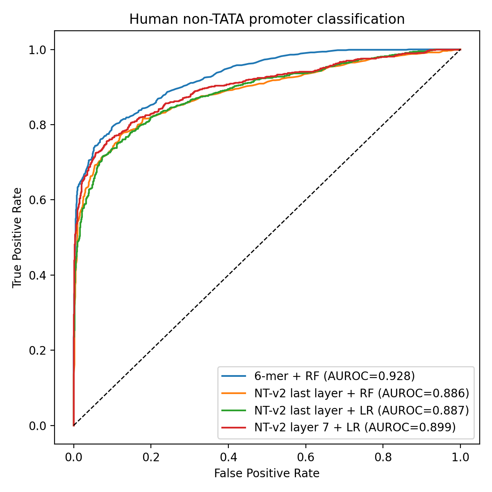

# DNA 언어모델 입문 실험: 사람 프로모터 서열 분류 비교

DNA 언어모델(Nucleotide Transformer)과 전통적인 k-mer 기반 머신러닝 중 어느 쪽이 사람 프로모터 서열을 더 잘 구분하는지 비교해 본 첫 번째 실험입니다. 유전체 데이터에 딥러닝을 적용하는 분야에 관심이 생겨, 공부하면서 직접 돌려본 과정을 시행착오까지 포함해 기록했습니다.

## 목적

DNA 서열 조각(251bp)이 프로모터인지 아닌지 분류하는 과제에서,

1. 단순한 6-mer 빈도 + 랜덤포레스트(기준선)
2. 사전학습된 DNA 언어모델의 임베딩 + 분류기

의 성능을 AUROC/AUPRC로 비교하고, 차이가 나는 이유를 추가 실험으로 확인하는 것이 목표입니다.

## 데이터

- **Genomic Benchmarks** – `human_nontata_promoters` (사람 non-TATA 프로모터 vs 비프로모터)
- 출처: https://github.com/ML-Bioinfo-CEITEC/genomic_benchmarks
- 실행 속도를 위해 일부만 무작위 추출해 사용: 학습 4,000개(클래스별 2,000), 테스트 2,000개(클래스별 1,000), `random.seed(42)`

## 방법

| 구분 | 특징 추출 | 분류기 |
|---|---|---|
| 기준선 | 6-mer 빈도 (`CountVectorizer`) | 랜덤포레스트 (300 trees) |
| DNA 언어모델 | Nucleotide Transformer v2 50M 임베딩 (mean pooling, 모델은 고정/미세조정 없음) | 랜덤포레스트, 로지스틱 회귀 |

- 모델: [InstaDeepAI/nucleotide-transformer-v2-50m-multi-species](https://huggingface.co/InstaDeepAI/nucleotide-transformer-v2-50m-multi-species)
- 평가 지표: AUROC, AUPRC
- 환경: Windows, 개인 PC GPU(CUDA), Python 3.10

## 결과

| 모델 | AUROC | AUPRC |
|---|---|---|
| 6-mer + 랜덤포레스트 | **0.928** | **0.937** |
| NT-v2 마지막 층 + 랜덤포레스트 | 0.886 | 0.909 |
| NT-v2 마지막 층 + 로지스틱 회귀 | 0.887 | 0.909 |
| NT-v2 7층 + 로지스틱 회귀 | 0.899 | – |



**층별 분석 (로지스틱 회귀, AUROC)**

| 층 | 0 | 1 | 2 | 3 | 4 | 5 | 6 | 7 | 8 | 9 | 10 | 11 | 12 |
|---|---|---|---|---|---|---|---|---|---|---|---|---|---|
| AUROC | 0.808 | 0.853 | 0.862 | 0.875 | 0.891 | 0.892 | 0.892 | **0.899** | 0.893 | 0.894 | 0.893 | 0.894 | 0.887 |

## 해석

- 예상과 달리 단순한 6-mer 기준선이 DNA 언어모델 임베딩보다 높은 성능을 보였습니다.
- 분류기를 랜덤포레스트에서 로지스틱 회귀로 바꿔도 결과가 거의 같아(0.886 → 0.887), 차이의 원인은 분류기가 아니라 임베딩에 담긴 정보로 보입니다.
- 층별로 보면 앞쪽 층에서 성능이 점점 오르다가 중간 층(7층)에서 가장 높았고, 마지막 층은 조금 낮았습니다. 마지막 층이 사전학습 과제(가려진 서열 맞히기)에 더 특화되어 있기 때문일 수 있다고 생각합니다.
- 결론적으로, 모델을 고정한 채 임베딩만 쓰는 방식으로는 이 과제에서 기준선을 넘지 못했습니다. 다음 단계로 과제에 맞춘 미세조정(LoRA)을 해보면 결과가 달라지는지 확인하고 싶습니다.

## 시행착오 기록

1. **DNABERT-2 사용 실패** – 처음에는 DNABERT-2를 쓰려 했으나, 모델 코드가 `triton` 패키지를 요구하는데 triton이 Windows를 공식 지원하지 않아 불러올 수 없었습니다. 그래서 triton이 필요 없는 Nucleotide Transformer로 바꿨습니다.
2. **transformers 버전 충돌** – 최신 transformers에서는 모델 코드가 쓰는 함수(`find_pruneable_heads_and_indices`)가 삭제되어 오류가 났고, `transformers==4.44.2`로 버전을 낮춰 해결했습니다.
3. **커널 재시작 후 재실행** – 패키지 버전을 바꾼 뒤 커널을 재시작하면서 변수가 사라져, 처음부터 다시 실행했습니다.

## 한계

- 전체 데이터가 아닌 일부(학습 4,000 / 테스트 2,000)만 사용했습니다.
- 랜덤 시드를 하나만 사용해 결과의 변동폭은 확인하지 못했습니다.
- 가장 작은 모델(50M)만 사용했고, 미세조정은 하지 않았습니다.

## 작업 방식에 대해

저는 생명과학 전공 학부생이고, 코딩과 딥러닝은 이제 막 공부를 시작한 단계입니다. 이번 실험은 AI(Claude)의 도움을 받아 진행했습니다. 환경 세팅과 코드 작성에 도움을 받았고, 직접 실행하면서 오류를 해결하고, 결과를 확인하며 각 단계가 무엇을 의미하는지 이해하려고 노력했습니다. 앞으로 직접 코드를 짜고 실험을 설계하는 비중을 늘려가는 것이 목표입니다.

## 실행 방법

```
conda create -n dna python=3.10
conda activate dna
pip install torch --index-url https://download.pytorch.org/whl/cu121
pip install -r requirements.txt
jupyter notebook
```

노트북을 위에서부터 순서대로 실행하면 데이터와 모델은 자동으로 내려받아집니다.
